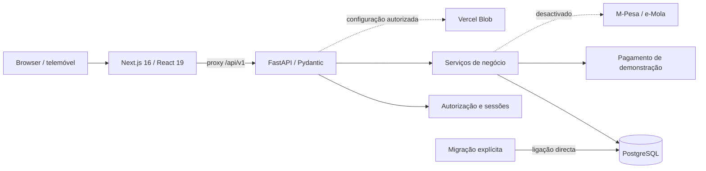

# Arquitectura e decisões

O frontend apresenta catálogo/formulários e consome API real. FastAPI valida pedidos, identifica o utilizador, verifica titularidade e aplica regras do domínio. PostgreSQL conserva os dados operacionais. Ausência de catálogo apresenta estado vazio; erro de ligação não é substituído por fixtures no browser.

## Organização

`frontend/app` mantém o App Router do esqueleto existente; `frontend/src` separa componentes, tipos, cliente HTTP e funcionalidades. Esta adaptação evita recriar a estrutura inicial. `backend/app` separa configuração, dados, modelos, schemas, serviços, integrações e routers. `backend/index.py` reutiliza a instância ASGI. Migração e seed são comandos explícitos.

Os componentes shadcn/ui são código local configurado em `frontend/components.json`. O Button usa Radix Slot e variantes CVA adaptadas ao desenho da Deloya; diálogos usam Radix e o estilo global usa Tailwind 4 e CSS. A composição segue a [documentação oficial do Button](https://ui.shadcn.com/docs/components/radix/button), permitindo manter a identidade visual nos componentes locais.

Compose expõe frontend 3000, API 8000 e PostgreSQL 5433 no host. O destino preparado é Vercel com dois projectos e Neon; preparação não significa publicação.

## Decisões de domínio

| Decisão | Justificação e consequência |
| --- | --- |
| `Listing` com `kind=product/service` | Evita duplicar pesquisa, imagens e moderação. Produtos exigem stock; serviços exigem stock nulo. Rotas públicas distinguem os tipos. |
| Candidatura em `Store.status` | A loja pendente conserva os dados e o titular; aprovação não duplica registos. |
| Um papel por utilizador | RBAC compacto `customer/vendor/admin`; a API aplica papel e titularidade. Não há editor público de papéis. |
| Carrinho como `CartItem` por utilizador | Unicidade utilizador/anúncio mantém carrinho persistente sem tabela cabeçalho vazia. |
| Encomenda e subencomendas | Cliente consulta agregado; vendedor recebe apenas a parcela da sua loja. |
| Snapshots nos itens | Nome e preço da compra não mudam quando o anúncio é editado. |
| Logística na encomenda/subencomenda | Morada, método e tarifa ficam ligados ao pedido; sem transportadoras fictícias. |
| `PaymentAttempt` como registo financeiro do MVP | Conserva montante, referência, provedor, estado e idempotência; não liquida fundos reais. |
| Decimal e `NUMERIC(12,2)` | Precisão monetária fixa no servidor; JSON transmite strings. |
| Arquivo e estados | Preservam relações e histórico em vez de reset destrutivo. |
| UTC no armazenamento | Interface converte para Africa/Maputo e dd/mm/aaaa. |

As entidades sugeridas no enunciado foram consolidadas quando pertencem ao mesmo agregado: produtos/serviços em anúncios, imagens em referências JSON, candidaturas em lojas e pagamentos em tentativas. Não se afirma existência de tabelas separadas que o código não contém. Ver [DATABASE.md](DATABASE.md).

## Consistência

Checkout revalida dados, calcula preço/tarifa e reserva stock em transacção PostgreSQL. Bloqueios de linhas protegem unidades concorrentes. Chaves de idempotência limitam duplicação; libertação de stock e actualização financeira são transaccionais.

Serviços não consomem unidades físicas. Solicitações exigem confirmação do vendedor e não representam agenda em tempo real. Preço sob consulta não é convertido num montante arbitrário no checkout.

## Identidade

JWT de acesso curto e sessão de refresh persistida; refresh é rotativo e conservado por hash. Cookies HttpOnly são acompanhados por CSRF nas mutações. O backend verifica papel e recurso; esconder um botão não concede segurança. O proxy Next permite chamadas na origem da interface e evita guardar tokens em localStorage.

## Evolução

Provedores reais, email de recuperação e armazenamento de anexos dependem de configuração e contratos externos. Não existem workers permanentes, desembolsos automáticos ou estatísticas de investigação produzidas pelo seed. Preparação arquitectural não equivale a validação para produção.
