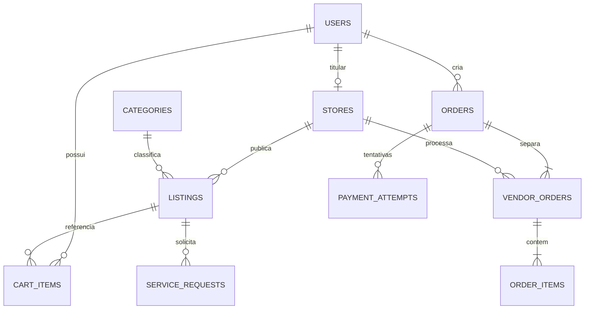

# Modelo de dados e migrações

PostgreSQL é obrigatório; SQLite não substitui testes de bloqueio. SQLAlchemy usa UUIDs, FKs, índices, constraints e timestamps com fuso. Quantias: `NUMERIC(12,2)` / `Decimal`, serializadas como strings JSON.

## Entidades

| Tabela | Finalidade e relações |
| --- | --- |
| `users` | Email único, contactos, hash Argon2, papel e indicador de conta de teste |
| `customer_addresses` | Moradas por utilizador e localização |
| `auth_sessions` | Sessão, família de refresh, hash, expiração e revogação |
| `rate_limit_buckets` | Contadores persistentes para operações limitadas |
| `categories` | Slug, hierarquia por categoria pai e estado |
| `stores` | Titular único, candidatura/estado, contacto, NUIT opcional, tarifa e pares privados de número/titular M-Pesa/e-Mola |
| `listings` | Anúncios produto/serviço, loja/categoria, imagens e moderação |
| `cart_items` | Anúncio e quantidade por utilizador; par único |
| `orders` | Cliente, referência, total, logística, estado e idempotência |
| `vendor_orders` | Parcela única por loja/encomenda, tarifa, processamento e snapshot dos destinatários de pagamento |
| `order_items` | Snapshot de nome, tipo, quantidade e preço |
| `payment_attempts` | Encomenda/parcela, referência interna e declarada, provedor, montante, destinatário e revisão pelo vendedor |
| `payment_config` | Disponibilidade administrativa do simulador |
| `audit_logs` | Actor, acção, recurso e detalhes sem segredos |
| `support_tickets` | Reclamação, encomenda opcional e resposta |
| `service_requests` | Pedido de serviço e data pretendida opcional |
| `uploaded_images` | Imagem pública carregada, caminho Blob e loja titular |
| `private_attachments` | Metadados de anexos privados de apoio; bytes em Blob privado, acesso por titular/admin |



## Invariantes

- SKU único por loja; slugs e referências de encomenda únicos.
- Produto exige preço, SKU e stock não negativo; serviço tem stock nulo e admite preço sob consulta.
- Carrinho aceita quantidades inteiras positivas limitadas; não usa quantidades negativas para aumentar stock.
- Loja: `pending`, `approved`, `suspended`. Anúncio: `draft`, `pending`, `published`, `rejected`, `archived`.
- Encomenda: `pendente_pagamento`, `paga`, `em_preparacao`, `pronta`, `entregue`, `cancelada`; a API limita as transições.
- Tentativa: `pending`, `success`, `failure`, `expired`; chave idempotente única por utilizador.
- Subencomenda única por loja/encomenda; o vendedor não recebe itens de outra loja.
- O indicador `is_demo` acompanha recursos de teste; o simulador não pode confirmar dinheiro real.

Índices cobrem titulares, estados e catálogo. Constraints não substituem autorização nem transacções de stock.

## Organização do modelo

`listings` reúne produtos e serviços; `images` conserva referências em JSON; `stores.status=pending` representa candidatura; carrinho não exige cabeçalho; logística fica em encomendas; tentativas representam o ciclo de pagamento. Estas escolhas reduzem duplicação sem misturar regras físicas e de serviço. Avaliações públicas exigem implementação e verificação de compra.

## Migrações e seed

Em `backend/`, com `DATABASE_DIRECT_URL` definida:

```powershell
python -m alembic current
python -m alembic upgrade head
python -m alembic history
```

Criar migração nova para futuras mudanças, rever o SQL e efectuar backup antes de alterar dados a preservar. Migrações não correm no import/startup de funções. Não há downgrade destrutivo automático. `DATABASE_URL` serve a API e `DATABASE_DIRECT_URL` serve migrações/administração. Em Neon, manter SSL e pooled/direct separados.

`python -m app.seed --demo` é comando opcional e idempotente. Não apagar dados para reaplicar seed.
